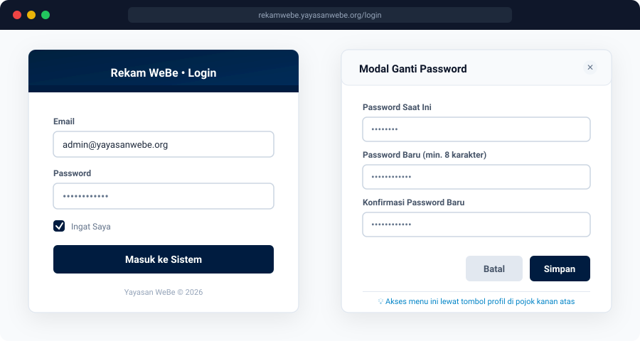
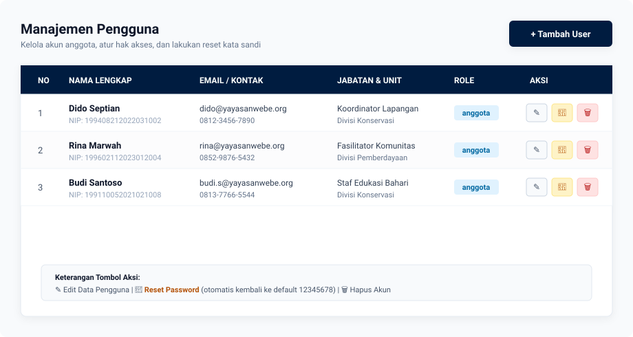
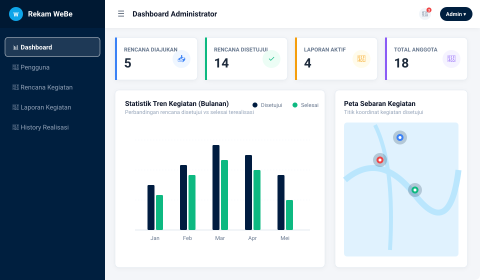
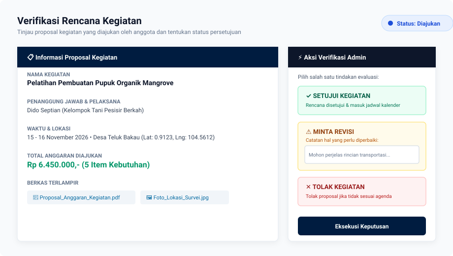
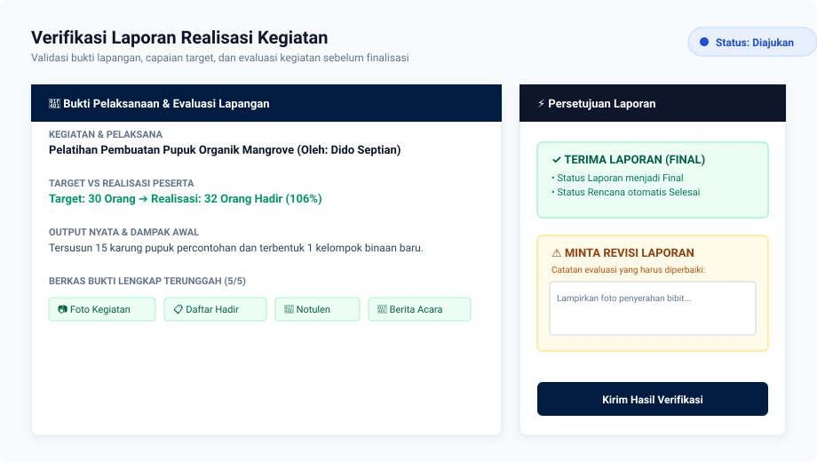
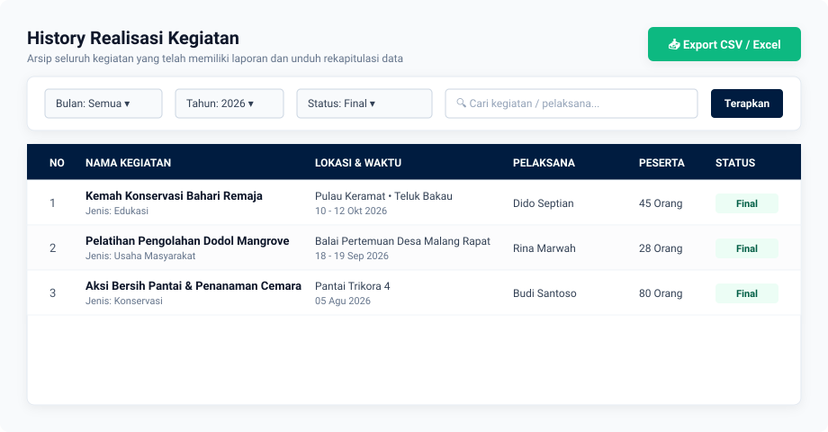

# 📖 Buku Panduan Penggunaan Rekam WeBe (Role: Admin / Supervisor)
**Sistem Perencanaan dan Pelaporan Realisasi Kegiatan Yayasan WeBe**

---

## 📌 1. Pendahuluan
Dokumen ini merupakan panduan ringkas dan praktis (*Quick Start Guide*) bagi **Administrator / Supervisor** dalam mengelola pengguna, memverifikasi pengajuan rencana kegiatan, menyetujui laporan pelaksanaan kegiatan, serta mengunduh rekap data kegiatan di aplikasi **Rekam WeBe**.

---

## 🔑 2. Login & Manajemen Akun

### 2.1 Masuk ke Aplikasi
1. Buka tautan aplikasi **Rekam WeBe** melalui peramban (Google Chrome / Mozilla Firefox / Microsoft Edge).
2. Masukkan **Email** dan **Password** Admin Anda.
3. Klik tombol **Login**.

### 2.2 Mengganti Password Admin
1. Klik nama Anda pada pojok kanan atas navbar.
2. Pilih menu **Ganti Password**.
3. Masukkan **Password Saat Ini**, buat **Password Baru** (minimal 8 karakter), lalu ulangi di kolom **Konfirmasi Password Baru**.
4. Klik tombol **Simpan Password**.

*Gambar 1: Halaman Login Sistem dan Modal Ubah Kata Sandi Akun*

---

## 👥 3. Manajemen Pengguna (Menu: Pengguna)

Admin memiliki wewenang penuh untuk mengatur akun anggota/staf pelaksana kegiatan.

### 3.1 Menambah Pengguna Baru
1. Buka menu **Pengguna** di sidebar kiri.
2. Klik tombol **+ Tambah User**.
3. Isi data form:
   - **Nama Lengkap**
   - **Email** (digunakan untuk login)
   - **No. HP / WhatsApp**
   - **Jabatan** & **Unit Kerja**
   - **NIK / NIP**
   - **Role**: Pilih `anggota`
4. Klik **Simpan**.
   > *Catatan: Akun baru otomatis dibuat dengan kata sandi default `12345678`. Anggota dapat menggantinya setelah login.*

### 3.2 Mengubah Data atau Role Pengguna
- Pada daftar pengguna, klik tombol **Edit** (ikon pensil).
- Perbarui informasi pengguna yang bersangkutan, lalu klik **Simpan**.
- Untuk mengubah peran, klik tombol status role lalu pilih role yang diinginkan.

### 3.3 Reset Password Pengguna
Gunakan fitur ini apabila anggota lupa kata sandi mereka:
1. Cari nama pengguna di tabel.
2. Klik tombol **Reset Password** (ikon kunci warna kuning).
3. Konfirmasi reset. Password pengguna akan diatur ulang kembali ke `12345678`.

### 3.4 Menghapus Pengguna
- Klik tombol **Hapus** (ikon tempat sampah warna merah) pada baris pengguna terkait.
- Konfirmasi penghapusan pada jendela pop-up.

*Gambar 2: Halaman Manajemen Pengguna, Tambah Akun, dan Tombol Reset Password*

---

## 📊 4. Monitoring Dashboard

Halaman Dashboard menyajikan informasi operasional secara terpusat:
- **Kartu Statistik**: Menampilkan jumlah rencana kegiatan diajukan, rencana disetujui, laporan masuk, dan total anggota.
- **Grafik Kegiatan Bulanan**: Tren kegiatan rencana dan realisasi selama 12 bulan (2 bulan terakhir hingga 9 bulan ke depan).
- **Kalender Kegiatan**: Jadwal kegiatan yang berstatus *Disetujui* per hari.
- **Peta Lokasi Kegiatan**: Peta persebaran titik lokasi koordinat kegiatan yang telah disetujui.
- **Tabel 5 Rencana Terbaru**: Menampilkan pengajuan kegiatan paling mutakhir dari anggota.

*Gambar 3: Dashboard Monitoring Administrator (Statistik, Tren Bulanan, Kalender, dan Peta Sebaran)*

---

## 📋 5. Verifikasi Rencana Kegiatan (Menu: Rencana Kegiatan)

Setiap rencana yang diajukan oleh anggota wajib ditinjau dan divalidasi oleh Admin.

### 5.1 Meninjau Pengajuan Rencana
1. Buka menu **Rencana Kegiatan**.
2. Anda dapat memanfaatkan filter **Status** (Diajukan, Disetujui, Revisi, Ditolak), **Bulan**, atau **Tahun**.
3. Klik tombol **Detail / Lihat** (ikon mata) pada kegiatan yang ingin diperiksa.
4. Periksa komponen rencana kegiatan:
   - Informasi dasar (Nama, Jenis, Kelompok, Penanggung Jawab, Deskripsi, Tujuan).
   - Waktu pelaksanaan & titik koordinat pada peta.
   - Tabel rincian estimasi biaya/kebutuhan.
   - Lampiran berkas proposal anggaran dan foto pendukung.

### 5.2 Mengambil Keputusan Verifikasi
Di halaman detail rencana, Admin dapat memilih salah satu aksi berikut:

- ✅ **Setujui Kegiatan**:
  - Klik tombol hijau **Setujui Kegiatan**.
  - Konfirmasi tindakan.
  - Status berubah menjadi `Disetujui`. Anggota akan menerima notifikasi dan kegiatan resmi masuk ke kalender & peta serta siap dilaporkan setelah selesai di lapangan.
- ⚠️ **Minta Revisi**:
  - Klik tombol kuning **Minta Revisi**.
  - Isi kolom **Catatan Revisi** (contoh: *"Mohon lampirkan rincian biaya transportasi dan perjelas tujuan kegiatan"*).
  - Klik **Kirim Revisi**. Status berubah menjadi `Revisi` dan catatan akan tampil pada akun anggota terkait.
- ❌ **Tolak Kegiatan**:
  - Klik tombol merah **Tolak Kegiatan**.
  - Masukkan **Alasan Penolakan**.
  - Klik **Tolak Rencana**. Status berubah menjadi `Ditolak`.

*Gambar 4: Halaman Verifikasi Rencana Kegiatan dan Panel Keputusan Admin (Setujui / Revisi / Tolak)*

---

## 📝 6. Verifikasi Laporan Kegiatan (Menu: Laporan Kegiatan)

Setelah anggota melaksanakan kegiatan di lapangan, mereka akan mengirimkan laporan realisasi.

### 6.1 Memeriksa Laporan Masuk
1. Buka menu **Laporan Kegiatan**.
2. Laporan yang membutuhkan tindakan verifikasi berstatus **Diajukan**.
3. Klik tombol **Detail / Lihat** (ikon mata).
4. Periksa poin realisasi:
   - Tanggal pelaksanaan riil dan rangkaian acara.
   - Realisasi jumlah peserta & profil peserta yang hadir.
   - Hasil yang dicapai, output nyata, dan dampak awal.
   - Kendala lapangan beserta solusi yang diambil.
   - Rekomendasi/evaluasi.
   - Berkas bukti: Galeri foto kegiatan, presensi/daftar hadir, notulen rapat, materi, dan berita acara.

### 6.2 Tindakan Persetujuan Laporan
- ✅ **Terima Laporan (Finalisasi)**:
  - Klik tombol hijau **Terima Laporan (Final)**.
  - Status laporan berubah menjadi `Final`.
  - Sistem secara otomatis memperbarui status Rencana Kegiatan terkait menjadi `Selesai`.
- ⚠️ **Minta Revisi Laporan**:
  - Klik tombol kuning **Minta Revisi Laporan**.
  - Tuliskan **Catatan Evaluasi** (misal: *"Foto kegiatan dan daftar hadir bertanda tangan belum diunggah"*).
  - Klik **Kirim Permintaan Revisi**. Status laporan berubah menjadi `Revisi`. Anggota akan memperbaiki dan mengajukan ulang.

*Gambar 5: Halaman Pemeriksaan Bukti Lapangan dan Aksi Persetujuan Laporan Realisasi*

---

## 📜 7. Rekap & Export Data (Menu: History Realisasi)

Menu ini menjadi bank data seluruh kegiatan yang telah memiliki laporan (Final, Diajukan, maupun Revisi).

### 7.1 Filter & Pencarian
Gunakan bilah filter di bagian atas tabel:
- **Tahun** & **Bulan** pelaksanaan.
- **Status Laporan** (Final / Diajukan / Revisi).
- **Jenis Kegiatan** (Konservasi, Edukasi, Usaha Masyarakat, Langsung, Lainnya).
- **Pencarian Kata Kunci** (berdasarkan nama kegiatan, lokasi, atau nama pelaksana).

### 7.2 Mengunduh Rekap CSV / Excel
1. Terapkan filter yang diinginkan (opsional jika ingin merekap periode/kategori tertentu).
2. Klik tombol hijau **Export CSV / Excel** di pojok kanan atas tabel.
3. Berkas `.csv` akan terunduh otomatis ke komputer Anda, diformat rapi (UTF-8) dan siap dibuka langsung di Microsoft Excel, Google Sheets, atau software pengolah data lainnya.

*Gambar 6: Halaman History Realisasi, Bilah Filter Pencarian, dan Tombol Export CSV / Excel*

---

## 🔔 8. Notifikasi Sistem
- Ikon lonceng di kanan atas navbar akan menampilkan tanda merah jika ada rencana kegiatan baru diajukan atau laporan kegiatan masuk dari anggota.
- Klik notifikasi untuk langsung menuju ke halaman detail pengajuan terkait.
- Tersedia opsi **Tandai Semua Sudah Dibaca** dan **Hapus Semua Notifikasi**.

---
*Manual Book Rekam WeBe - Versi 1.1 (Admin)*
